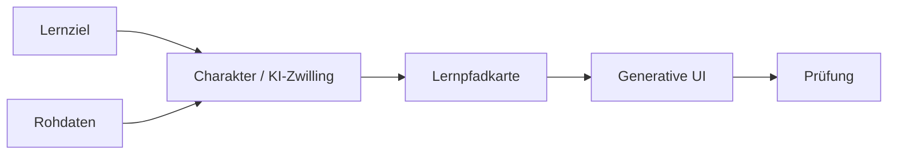

# 6. Laufzeitsicht

## 6.1 Vom Lernziel zur Prüfung

Ablauf aus dem ersten Zuschnitt in Software, festgehalten unter [Transformation](../process.md#transformation). Die Schritte tragen dieselben Namen wie die Verantwortungen in der [Bausteinsicht](05-bausteinsicht.md). Welche Bausteine welchen Schritt ausführen, und wie Fehler behandelt werden, ist offen.

1. **Lernziel.** Die lernende Person benennt, was sie erreichen will.
2. **Charakter / KI-Zwilling.** Aus dem Lernziel und den Rohdaten entsteht ein Charakter der lernenden Person.
3. **Lernpfadkarte.** Aus dem Charakter wird eine Karte des Lernwegs.
4. **Generative UI.** Die Karte wird zur Oberfläche, in der gelernt wird.
5. **Prüfung.** Der Weg führt zur Prüfung. Der Schwerpunkt liegt auf dem Lernen bis dorthin, siehe [Transformation](../process.md#transformation).

Offen aus der Ideensammlung, noch ohne eigenes Szenario: Mehrere Lösungen laufen im Hintergrund mit dem digitalen Zwilling. Konkrete Formen der Oberfläche, etwa zerlegte Texte, ein Chat über eine Videovorlesung oder eine Browser-Erweiterung, sind Beispiele.
