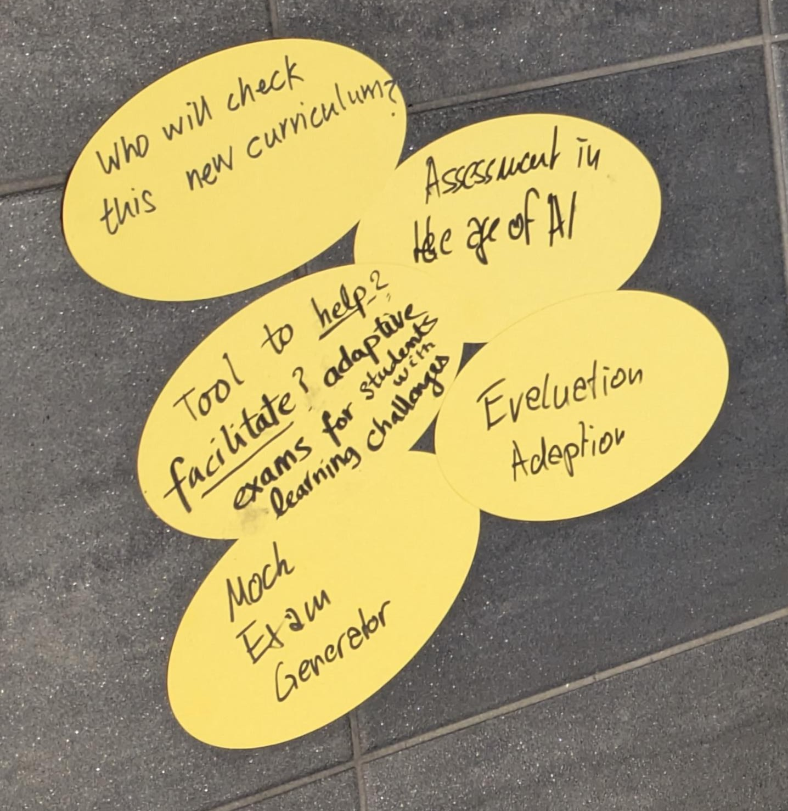
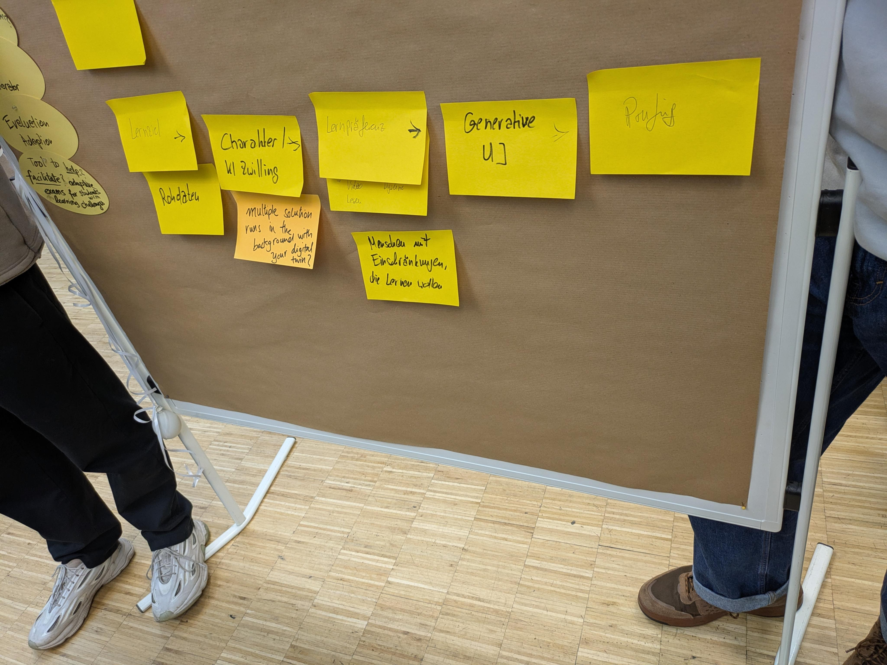

# Prozess

Diese Datei beschreibt, wie die [Grundidee](../README.md#grundidee) entstanden ist.

## Auslöser

Konkreter Auslöser war die Schilderung eines Teammitglieds: Lehrkräften fehlt heute die Zeit, in Prüfungen auf besondere Bedürfnisse einzugehen, hier die Lese-Rechtschreibschwäche. Die Prüfungen sind deshalb nicht darauf angepasst, obwohl der Grundgedanke der Inklusion genau das fordert.

Festgehalten ist das auf dem nachfolgenden Foto. Der Auslöser auf dem Bild war die Karte „Tool to help … adaptive exams“.

## Transformation

Um das konkrete Problem in einen größeren Kontext zu setzen, haben wir uns entschieden, nicht die konkrete Prüfung in den Mittelpunkt zu stellen, sondern uns auf den Lernprozess auf dem Weg zum erfolgreichen Bestehen einer Prüfung zu fokussieren.

Im folgenden Foto ist der erste Versuch zu erkennen, wie das Ganze als Abfolge von Schritten in Software aussehen kann.

## Fokussierung

Um aus dem breiten Lösungsraum konkrete Lösungsideen zu entwickeln, nutzen wir Personas. So werden die Ideen greifbarer, und es entstehen umsetzbare Elemente für einen Hackathon.
